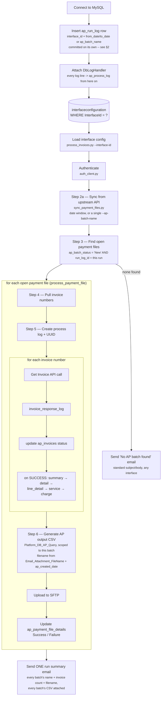
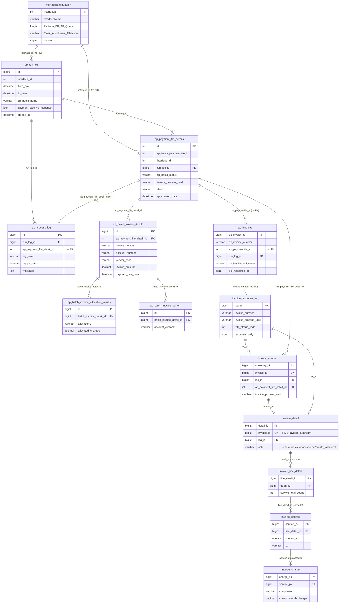

# Mangesh Automation — Invoice Sync Pipeline

For a given interface (`interfaceconfiguration.InterfaceId`), authenticates
against that interface's Invoice API, pulls new AP payment-file batches and
their invoice numbers from the upstream platform (Get Payment Batches / Get
Invoice List APIs) into `ap_payment_file_details` / `ap_invoices`, then finds
every open (`'New'`) payment-file batch, pulls the invoice numbers under each
batch from `airflow.ap_invoices`, fetches full invoice detail for each
invoice number, writes the outcome back onto `ap_invoices`, and stores the
full nested API response (summary → detail → line items → services →
charges) into normalized tables. Each run gets its own tracking UUID
(`ap_payment_file_details.invoice_process_uuid`) and, separately, its own
`ap_run_log` row (inserted before anything else happens — see §2) so every
batch pulled and every log line emitted during that invocation can be traced
back to it. For every open batch it then generates an AP output CSV (driven
by that interface's own `Platform_DB_AP_Query`, scoped to that batch — see
§8), uploads it to SFTP, and writes the batch's status back to
`ap_payment_file_details` (`Success`/`Failure`). Once every batch in the run
has been processed, one summary email goes out listing all of them together
(batch names, total invoice count, all output filenames, every CSV
attached) — see §8.

A companion web app, the **AP Tracker** (`tracker/`, React + Node), sits on top
of the same MySQL database: it manages `interfaceconfiguration`, monitors runs,
batches, API calls and stored invoice data, and can reprocess a single batch
on demand — see [§9](#9-ap-tracker-web-app) and [`tracker/README.md`](tracker/README.md).

## Contents

- [1. Architecture / Process Flow](#1-architecture--process-flow)
- [1a. Folder Structure](#1a-folder-structure)
- [2. Database Schema](#2-database-schema)
  - [2a. Database Architecture Diagram](#2a-database-architecture-diagram)
- [3. Project Files](#3-project-files)
- [4. Configuration](#4-configuration)
- [5. Function Reference](#5-function-reference)
- [6. Status Derivation Logic](#6-status-derivation-logic)
- [7. Execution Steps](#7-execution-steps)
  - [7.1 Prerequisites](#71-prerequisites)
  - [7.2 Install dependencies](#72-install-dependencies)
  - [7.3 Create / migrate the database schema](#73-create--migrate-the-database-schema)
  - [7.4 Configure credentials](#74-configure-credentials)
  - [7.5 Run the pipeline directly](#75-run-the-pipeline-directly)
  - [7.6 Run the pipeline via Airflow](#76-run-the-pipeline-via-airflow)
  - [7.7 Ad hoc data inspection](#77-ad-hoc-data-inspection)
  - [7.8 Export all invoice data to CSV standalone (no run scoping)](#78-export-all-invoice-data-to-csv-standalone-no-run-scoping)
  - [7.9 Step-through debugging in VS Code](#79-step-through-debugging-in-vs-code)
- [8. Technical Notes](#8-technical-notes)
- [9. AP Tracker (web app)](#9-ap-tracker-web-app)

---

## 1. Architecture / Process Flow



The diagram above is the shape of the flow; the exact tables and queries at
each step are:

1. **Connect to MySQL, then insert `ap_run_log`** — `process_invoices.py::main()`
   opens the DB connection first, then immediately inserts and commits one
   `ap_run_log` row (`interface_id` + whichever of `from_date`/`to_date` or
   `ap_batch_name` was passed, all `NULL` otherwise) *before* anything else —
   so this record survives even if the rest of the run later fails. `DbLogHandler`
   (`db_log_handler.py`) is then attached to the root logger, tagged with that
   row's id: every log line emitted from here on is also written to
   `ap_process_log` (see §2, §8).
2. **Load interface config** — `process_invoices.py --interface-id N` →
   `repository.py::load_interface_configuration()` maps `SFTP_*`/`SMTP_*`/
   `Platform_*`/`Email_*` columns onto `config.py`'s dotted keys, overlaid
   onto `appsettings.yml` (DB values win; `NULL` columns fall back to YAML).
3. **Authenticate** (`auth_client.py`) — `POST {BaseUri}/api/v2/Authenticate`
   → Bearer token.
4. **Step 2a — Sync payment files + invoices from upstream**
   (`sync_payment_files.py`) — no dedup, every batch the API returns gets a
   fresh insert every run, even ones already seen (see §8):
   - `GET {BaseUri}/api/v2/invoices/invoiceAPBatches`, either over a
     `fromDate`/`toDate` window (ISO 8601 UTC, `yyyy-MM-ddTHH:mm:ssZ`) or, if
     `--ap-batch-name` was given, filtered to just `apBatchName` instead (no
     date window at all — see §5, §7.5) → every batch inserted as a new
     `ap_payment_file_details` row — the pipeline-owned tracking columns
     (`ap_batch_status='New'`, `processed_date`, `invoice_process_uuid`,
     `run_log_id`) alongside the raw API record (`Client`, `ApPaymentFileStatus`,
     amounts, etc. — the API returns PascalCase field names here, see §8) on
     the same row.
   - for each batch: `GET {BaseUri}/api/v2/invoices/invoiceAPBatchesDetails?paymentFileId=...`
     → `invoiceAPBatchDetails[].invoiceNumber` inserted into `ap_invoices`;
     each entry is also inserted into `ap_batch_invoice_details`, with its
     nested `allocationValues[]`/`custom[]` inserted into their own child
     tables.
5. **Step 3 — Find open payment files**
   (`repository.py::get_open_payment_files()`):
   `SELECT * FROM ap_payment_file_details WHERE interface_id = ? AND run_log_id = ? AND ap_batch_status = 'New'`.
   Only the batches pulled by **this run's** `ap_run_log.id` are processed —
   `New` rows left behind by an earlier run that died before processing them
   are deliberately ignored (they stay `New`; nothing cleans them up).
   If this finds **no** batch, `delivery.py::send_no_batch_email()` sends a
   standard "No AP batch found" email (see step 11a) and the run ends.

**For each open payment file** (`process_invoices.py::process_payment_file`):

6. **Step 4 — Pull invoices for this payment file** —
   `SELECT ap_invoice_id, ap_invoice_number FROM ap_invoices WHERE ap_paymentfile_id = <payment file's id> AND run_log_id = <this run>`
   (grouped into `{invoice_number: [ap_invoice_id, ...]}`).
7. **Step 5 — Start the run** (`repository.py::start_batch_run()`) —
   `UPDATE ap_payment_file_details SET invoice_process_uuid = ? WHERE id = ?`
   — a freshly generated UUID recorded on the batch row before any invoice is
   processed (formerly a separate `ap_invoices_process_log` row per run — see
   §8).
8. **Step 6 — Process every invoice in this batch**
   (`process_invoices.py::process_invoice`) — for each `invoice_number`:
   - Get Invoice API call → `invoice_response_log` (+ `invoice_process_uuid`)
   - update `ap_invoices` (status / raw response) — `WHERE ap_invoice_id IN (...) AND ap_paymentfile_id = ? AND run_log_id = ?`
   - on `SUCCESS`: `invoice_summary` (+ `invoice_process_uuid`,
     `ap_payment_file_detail_id`) → `invoice_detail` → `invoice_line_detail`
     → `invoice_service` → `invoice_charge`
9. **Generate the AP output CSV, upload to SFTP**
   (`export_invoices_csv.py::export_ap_batch_csv()`, `delivery.py::upload_to_sftp()`)
   — runs this interface's `interfaceconfiguration.Platform_DB_AP_Query`
   (`cfg.platform_db_ap_query`), parameterized by
   `%(ap_payment_file_detail_id)s` so the CSV only covers this batch; the
   filename comes from `Email_Attachment_FileName` (e.g. `CBTS_{ap_batch_date}`)
   resolved against this batch's `ap_created_date` (`mmddyyyy`, see §8), and
   whether it has a header row comes from `IncludeHeader`
   (`cfg.output.include_header`, default `true`). Uploads that file to SFTP.
   `process_payment_file()` returns a result dict (batch name, invoice count,
   output path/filename, status) instead of emailing here — see step 11.
10. **Update `ap_payment_file_details`**: `ap_batch_status = 'Success'/'Failure'`,
    `processed_date = now`.
11. **Send one run-level summary email** (`main()`, after every batch in
    this run has been processed — `delivery.py::send_run_summary_email()`) —
    lists every batch processed (names, total invoice count, output
    filenames, comma-joined) with every batch's CSV attached, in one HTML
    email. Replaces the older per-batch success/failure emails (see §8).

11a. **No-batch email** (`main()`, right after step 3, only when this run's
    `run_log_id` has no open batch — `delivery.py::send_no_batch_email()`) —
    applies to all four run modes (interface only, `--ap-batch-name`, a single
    date, a from/to range). Same sender, recipients (`Email_Recipients_To/Cc`)
    and `Email_Enabled` as the summary email, but a **fixed subject/body**
    (`[<interface>] No AP batch found - <date>`) so a newly configured
    interface needs no extra setup. The body shows the interface name/ID, run
    log id, the search criteria (the batch name, `Date X`, or `From X to Y` —
    for a default run, the actual lookback window used), and how many batches
    the API returned. A failed send is logged and does not fail the run.

---

## 1a. Folder Structure

```
mangesh_automation/
├── .vscode/
│   └── launch.json           VS Code debug configurations (see §7.9)
├── config/
│   ├── appsettings.yml       MySQL connection + fallback defaults (see §4)
│   └── field_maps.yml        API field -> DB column mappings
├── scripts/
│   ├── config.py              loads appsettings.yml, overlays interface_values
│   ├── logging_config.py      console-only root logger setup (no file handler)
│   ├── db_log_handler.py      DbLogHandler -- mirrors every log record into ap_process_log
│   ├── log_context.py         contextvar tagging log records with the current batch id
│   ├── field_maps.py          loads field_maps.yml
│   ├── db.py                  shared MySQL connection pool (SQLAlchemy engine; get_connection / get_engine)
│   ├── auth_client.py         Authenticate API client
│   ├── invoice_client.py      Get Invoice / Get Payment Batches / Get Invoice List API clients
│   ├── repository.py          all DB read/write functions
│   ├── sync_payment_files.py  pulls new payment files + invoice numbers from upstream API
│   ├── process_invoices.py    main orchestrator (entry point)
│   ├── fetch_ap_invoices.py   standalone ap_invoices reader
│   ├── export_invoices_csv.py AP output CSV (Platform_DB_AP_Query-driven, per batch) + the older Output.Tables-driven full export (standalone, §7.8)
│   ├── delivery.py            SFTP upload + run-level summary email (see §8)
│   ├── secret_crypto.py       AES-256-GCM decrypt_secret() for tracker-encrypted interfaceconfiguration secrets (§7.4, §9)
│   └── make_secret_update_sql.py  prompts for Platform_Password / Platform_AppAuthKey and prints an UPDATE with enc:v1: values (§7.4)
├── dags/
│   ├── invoice_sync_dag.py              Airflow DAG, hard-coded INTERFACE_ID, runs process_invoices.main(...)
│   ├── invoice_sync_parametrized_dag.py same, interface id from Airflow Variable invoice_sync_interface_id
│   └── invoice_execution_dag.py         preflight check -> run; interface id from Variable invoice_execution_interface_id
├── docs/
│   ├── dag-deployment.md               deployment runbook for the Airflow DAG
│   └── function-execution-reference.md call order / inputs / outputs of every Python function
├── tracker/                   AP Tracker web app (backend: Node/Express/TS, frontend: React/Vite) -- see §9
├── sql/
│   ├── create_tables.sql                   full DDL for a fresh install + seed data
│   ├── migrate_payment_file_processing.sql catch-up ALTERs for a pre-existing DB
│   ├── create_invoice_response_log.sql     standalone DDL for the log table
│   ├── create_batch_detail_tables.sql      standalone DDL for the payment-file-sync feature
│   ├── create_run_log_table.sql            standalone DDL for ap_run_log + ap_payment_file_details.run_log_id
│   ├── create_process_log_table.sql        standalone DDL for ap_process_log
│   ├── apply_logging_changes.sql           combined run_log_table + process_log_table migration, one script
│   ├── update_platform_db_ap_query.sql     sets Platform_DB_AP_Query + Email_Attachment_FileName for one interface
│   ├── update_email_summary_template.sql   sets Email_Subject/Email_Body to the run-summary HTML template
│   ├── migrate_merge_ap_batch_details.sql  folds a retired 1:1 table into ap_payment_file_details
│   ├── migrate_merge_ap_invoices_process_log.sql  folds a retired run-history table into ap_payment_file_details
│   ├── alter_run_log_and_response_columns.sql  ALL run_log_id / JSON-response columns in one re-runnable script (guarded; run on an existing DB)
│   ├── add_invoice_list_response_to_payment_file_details.sql  adds ap_payment_file_details.invoice_list_response (JSON); run on an existing DB
│   ├── add_payment_batches_response_to_run_log.sql  adds ap_run_log.payment_batches_response (JSON); run on an existing DB
│   ├── add_run_log_id_to_ap_invoices.sql   adds ap_invoices.run_log_id (+ index, FK -> ap_run_log); run on an existing DB
│   ├── drop_aprequestpaymentdetails.sql    drops a retired legacy table
│   └── drop_aprequestdetails.sql           drops a retired legacy table
├── output/                    generated AP output CSVs land here (see Output config)
├── logs/                      no longer written to (logging is console + ap_process_log now, see §8)
├── requirements.txt
└── README.md
```

---

## 2. Database Schema

Defined in [`sql/create_tables.sql`](sql/create_tables.sql) (`CREATE TABLE IF NOT
EXISTS`, safe to re-run on a fresh database). If a database already has these
tables in their pre-payment-file-tracking shape (interfaceconfiguration,
ap_payment_file_details, ap_invoices_process_log, invoice_summary already exist
but predate this flow), run
[`sql/migrate_payment_file_processing.sql`](sql/migrate_payment_file_processing.sql)
once instead — `CREATE TABLE IF NOT EXISTS` is a no-op against tables that
already exist, so it won't retroactively add new columns.

### 2a. Database Architecture Diagram



`interfaceconfiguration.InterfaceId` → `ap_run_log.interface_id` /
`ap_payment_file_details.interface_id`, `ap_payment_file_details.id` →
`ap_invoices.ap_paymentfile_id`, and `ap_invoices.invoice_number` →
`invoice_response_log.invoice_number` are logical links only — none of them
are enforced `FOREIGN KEY` constraints in the DDL (matching columns, joined
by the application code, not the database). Everything else shown as a solid
relationship line **is** an enforced FK. `invoice_line_detail` →
`invoice_service` → `invoice_charge` cascade-delete on their parent; nothing
else does.

| Table | Purpose | Key relationship |
|---|---|---|
| `interfaceconfiguration` | One wide row per interface (SFTP/SMTP/Invoice API/email settings) | `InterfaceId` (PK) |
| `ap_run_log` | One row per `process_invoices.py` invocation, inserted and committed on its own at the very start of `main()` — before interface config is loaded, before auth, before anything else — so it survives even if the run fails later. Captures exactly what was passed on the CLI: `interface_id` always, plus either `from_date`/`to_date`, or `ap_batch_name` (`--ap-batch-name`), or neither (default `GetPaymentBatches.LookbackDays` window) — whichever weren't used stay `NULL`. `payment_batches_response` (JSON) holds the records the Get Payment Batches API returned for the run (all pages, one array), saved and committed right after that call and before any batch is inserted; `NULL` until the call completes | anchors `ap_payment_file_details.run_log_id` and `ap_process_log.run_log_id` |
| `ap_process_log` | One row per log record emitted anywhere in the pipeline during a run (any module, any level) — replaces file-based logging entirely, see §8. `ap_payment_file_detail_id` is set when the record was emitted from inside a batch's processing block, `NULL` for run-level lines | `run_log_id` → `ap_run_log.id` (FK) · `ap_payment_file_detail_id` → `ap_payment_file_details.id` (**no FK, deliberately** — see §8, avoids a cross-connection lock wait against that row's uncommitted insert) |
| `ap_invoices` | Source list of invoices to process; also stores the last API call outcome. `run_log_id` records the run that pulled the row | `ap_paymentfile_id` → `ap_payment_file_details.id` · `run_log_id` → `ap_run_log.id` |
| `ap_payment_file_details` | One row per payment-file batch **per sync pull** — `ap_batch_payment_file_id` is *not* unique; the same upstream batch gets a fresh row (and is fully reprocessed) every run that its `paymentFileId` still falls inside the sync window, see §8. `ap_batch_status` (`New`/`Success`/`Failure`) drives the foreach loop. `invoice_process_uuid` holds the current run's UUID (merged in from a separate `ap_invoices_process_log` table, see §8) and is threaded into `invoice_response_log` and `invoice_summary`. `run_log_id` ties this row back to the `ap_run_log` row for the run that pulled it (nullable — rows inserted before this column existed have no run to point to). Also carries the raw Get Payment Batches API record for that batch (`client`, `ap_payment_file_status`, `no_of_invoices`, `no_of_vendors`, `earliest_due_date`, `currency`, `invoice_amount`, `allocated_amount`, `detail_invoice_amount`, `fetched_datetime`) and `invoice_list_response` (JSON: the records the Get Invoice List API returned for that batch, all pages as one array, saved alongside the parsed `ap_batch_invoice_*` rows; `NULL` until that call completes) — merged in from a separate `ap_batch_details` table, see §8 | `interface_id` → `interfaceconfiguration.InterfaceId` · `run_log_id` → `ap_run_log.id` |
| `ap_batch_invoice_details` | Raw `invoiceAPBatchDetails[]` entry from the Get Invoice List API — flat invoice-line fields (org/vendor/dates/amounts) | `ap_payment_file_detail_id` → `ap_payment_file_details.id` |
| `ap_batch_invoice_allocation_values` | `invoiceAPBatchDetails[].allocationValues[]` child rows | `batch_invoice_detail_id` → `ap_batch_invoice_details.id` |
| `ap_batch_invoice_custom` | `invoiceAPBatchDetails[].custom[]` child rows | `batch_invoice_detail_id` → `ap_batch_invoice_details.id` |
| `invoice_response_log` | One row per Get Invoice API call: raw JSON response, HTTP status, timestamp, `invoice_process_uuid` | root of the invoice-detail chain |
| `invoice_summary` | Short `records[]` shape from the API | `invoice_id` (unique) · `log_id` → `invoice_response_log` · `invoice_process_uuid` / `ap_payment_file_detail_id` → this run's batch |
| `invoice_detail` | Full `records[]` shape (all ~77 fields, when `expand=true`) | `invoice_id` (unique) → `invoice_summary` · `log_id` → `invoice_response_log` |
| `invoice_line_detail` | `invoiceDetails[]` wrapper (`serviceTotalCount`) | `detail_id` → `invoice_detail` (cascade delete) |
| `invoice_service` | `invoiceServices[]` | `line_detail_id` → `invoice_line_detail` (cascade delete) |
| `invoice_charge` | `invoiceCharges[]` | `service_pk` → `invoice_service` (cascade delete) |

> [!NOTE]
> **Idempotency**: `invoice_summary` / `invoice_detail` are upserted on
> `invoice_id` (`ON DUPLICATE KEY UPDATE`) — so re-processing the same
> invoice under a *new* run updates that invoice's `invoice_process_uuid` in
> place rather than adding a row. Nested rows (`invoice_line_detail` →
> `invoice_service` → `invoice_charge`) are deleted and re-inserted per
> `detail_id` on every run. What used to make re-runs look like
> "duplicates" was the CSV export pulling the whole table's history
> unscoped; the export now filters `invoice_summary` by the current run's
> `invoice_process_uuid` (see §1), so each batch's output only contains
> that batch's invoices.

---

## 3. Project Files

| File | Role |
|---|---|
| `config/appsettings.yml` | MySQL connection, Invoice API base structure, `Output.Tables` join config, logging — plus fallback `Sftp`/`Email`/`InvoiceApi.Authentication` defaults for any interface whose `interfaceconfiguration` row leaves those columns `NULL` |
| `config/field_maps.yml` | API field → DB column (snake_case) mappings for Summary / Detail / Service / Charge / BatchDetails / BatchInvoiceDetails / BatchInvoiceAllocationValue / BatchInvoiceCustom. Field-name casing varies by endpoint: `BatchDetails` (the `invoiceAPBatches` batch-list record) is **PascalCase** (`Client`, `PaymentFileId`, `ApBatchName`, `ApCreatedDate`, ... — confirmed against a live response), everything else is camelCase — see §8 |
| `scripts/config.py` | Loads `config/appsettings.yml` into typed dataclasses (`AppConfig`, `MySqlConfig`, `InvoiceApiConfig`, `AuthenticationConfig`, `GetInvoiceConfig`, `GetPaymentBatchesConfig`, `GetInvoiceListConfig`, `LoggingConfig`, `JobConfig`, `SftpConfig`, `EmailConfig`); `load_config(interface_values=...)` overlays a dict of dotted keys (e.g. `"Sftp.Password"`) on top of the YAML before building the dataclasses |
| `scripts/logging_config.py` | `setup_logging(cfg)` — console-only root logger setup (no file handler — see `db_log_handler.py` below and §8); exports `LOG_FORMAT` |
| `scripts/db_log_handler.py` | `DbLogHandler(logging.Handler)` — attached to the root logger once `run_log_id` is known; mirrors every log record (any module, any level) into `ap_process_log`, tagged with `run_log_id` and (via `log_context.py`) the current batch's `ap_payment_file_detail_id` when applicable. Own autocommit connection, never raises out of `emit()` |
| `scripts/log_context.py` | `current_payment_file_detail_id` — a `contextvars.ContextVar`, set/reset around each batch's processing block in `sync_payment_files.py` and `process_invoices.py::process_payment_file()`, read by `DbLogHandler` |
| `scripts/field_maps.py` | Loads `config/field_maps.yml`, exposes `SUMMARY_FIELD_MAP` / `DETAIL_FIELD_MAP` / `SERVICE_FIELD_MAP` / `CHARGE_FIELD_MAP` / `BATCH_DETAILS_FIELD_MAP` / `BATCH_INVOICE_DETAIL_FIELD_MAP` / `BATCH_INVOICE_ALLOCATION_VALUE_FIELD_MAP` / `BATCH_INVOICE_CUSTOM_FIELD_MAP` and `map_record()` |
| `scripts/db.py` | Shared connection pool: one SQLAlchemy engine per process/database (`pool_size` = `MySql.PoolSize`, default 5; `pool_pre_ping`; `pool_recycle` 30 min; no overflow). `get_connection(cfg)` returns a pooled DBAPI connection (`close()` returns it to the pool) for transactional multi-table writes; `get_engine(cfg)` is the same engine for pandas; `set_autocommit(conn, bool)` sets it on the real driver connection (reset to `False` before `close()`); `dispose_engines()` closes the pool at the end of a run. A run holds 3 connections at once: main, `DbLogHandler`, and a CSV export |
| `scripts/auth_client.py` | `authenticate(cfg)` — calls the Authenticate API, returns the bearer token |
| `scripts/invoice_client.py` | `get_invoice(cfg, token, invoice_number)` — calls the Get Invoice API; `get_payment_batches(cfg, token, from_date=None, to_date=None, page=1, ap_batch_name=None)` — calls the Get Payment Batches API, either by date window or by `ap_batch_name` (mutually exclusive); `get_invoice_list(cfg, token, payment_file_id, page)` — calls the Get Invoice List API |
| `scripts/repository.py` | All DB read/write functions (see §5) |
| `scripts/sync_payment_files.py` | `sync_payment_files(cursor, cfg, token, interface_id, from_date=None, to_date=None, ap_batch_name=None, run_log_id=None, conn=None)` — pulls new payment-file batches (Get Payment Batches API, saving the raw response records on `ap_run_log.payment_batches_response`, by date window or by a single `ap_batch_name`) into `ap_payment_file_details` (tracking columns + the raw API record + `run_log_id`, on the same row), then for each new batch pulls its invoice numbers (Get Invoice List API) into `ap_invoices` + each raw `invoiceAPBatchDetails[]` entry into `ap_batch_invoice_details` (its nested `allocationValues[]`/`custom[]` into their own child tables); paginates both APIs via `data.totalPages`. `from_date`/`to_date` default to `[today - GetPaymentBatches.LookbackDays, today]` when neither they nor `ap_batch_name` are given |
| `scripts/process_invoices.py` | Main orchestrator — entry point for the full pipeline, takes `--interface-id` plus either optional trailing date argument(s) or `--ap-batch-name` (see §5, §7.5) |
| `scripts/fetch_ap_invoices.py` | Standalone helper — reads `ap_invoices` into a pandas DataFrame (ad hoc use / debugging) |
| `scripts/export_invoices_csv.py` | `export_ap_batch_csv()` — the AP output CSV the main pipeline generates per batch, driven by `interfaceconfiguration.Platform_DB_AP_Query` (see §8). Also still has the older `export_invoices_csv()`, joining `invoice_summary` → `invoice_detail` → `invoice_line_detail` → `invoice_service` → `invoice_charge` via `Output.Tables`, optionally scoped to one `invoice_process_uuid` — no longer called by the main pipeline, but still usable standalone (§7.8) |
| `scripts/delivery.py` | `upload_to_sftp()` puts the CSV on the SFTP server; `send_run_summary_email()` sends the one run-level summary email with every batch's CSV attached (the older per-batch `send_success_email()` / `send_failure_email()` remain but are no longer called by the main flow — see §8). All log their outcome. |
| `scripts/secret_crypto.py` | `decrypt_secret()` — decrypts `enc:v1:<base64>` AES-256-GCM values written by the tracker into the `interfaceconfiguration` secret columns, keyed by the `INTERFACE_SECRET_KEY` env var; values without the prefix pass through as legacy plaintext. Called from `repository.py::load_interface_configuration()` |
| `dags/invoice_sync_dag.py` | Airflow DAG — schedules `scripts/process_invoices.py:main(interface_id=INTERFACE_ID)` as a `PythonOperator` task |
| `dags/invoice_sync_parametrized_dag.py` | Same, but the interface id comes from the Airflow Variable `invoice_sync_interface_id` (default 1) |
| `dags/invoice_execution_dag.py` | `preflight` task (DB reachable + active `interfaceconfiguration` row) followed by `run_invoice_sync`; interface id from the Variable `invoice_execution_interface_id` (default 1) |
| `docs/dag-deployment.md` / `docs/function-execution-reference.md` | Airflow deployment runbook / per-function execution reference |
| `tracker/` | The AP Tracker web app (see §9) |
| `sql/create_tables.sql` | Full DDL for every table (fresh-install shape) + seed rows for `ap_invoices` / `ap_payment_file_details` |
| `sql/migrate_payment_file_processing.sql` | Catch-up `ALTER TABLE` statements for a database that already has these tables in their older shape |
| `sql/create_invoice_response_log.sql` | Standalone DDL for just `invoice_response_log` |
| `sql/create_batch_detail_tables.sql` | Standalone DDL for the payment-file-sync feature — adds the 11 raw-API columns to `ap_payment_file_details` plus `ap_batch_invoice_details` / `ap_batch_invoice_allocation_values` / `ap_batch_invoice_custom` — for a database that already runs this pipeline but predates that feature |
| `sql/create_run_log_table.sql` | Standalone DDL for `ap_run_log` + `ap_payment_file_details.run_log_id` (FK) — for a database that predates the run-log feature |
| `sql/create_process_log_table.sql` | Standalone DDL for `ap_process_log` — for a database that predates the DB-backed process-logging feature |
| `sql/migrate_merge_ap_batch_details.sql` | Folds the now-retired `ap_batch_details` table into `ap_payment_file_details` — only needed if you ran an earlier version of this pipeline that had `ap_batch_details` as a separate table (see §8) |
| `sql/migrate_merge_ap_invoices_process_log.sql` | Folds the now-retired `ap_invoices_process_log` table into `ap_payment_file_details` (`invoice_process_uuid` column, `log_id` dropped) — only needed if you ran an earlier version of this pipeline that had that table (see §8); also retires the tracker's "Run Logs" feature |
| `sql/drop_aprequestpaymentdetails.sql` / `sql/drop_aprequestdetails.sql` | Drop the two legacy tables neither this pipeline nor the tracker ever read (see §8) |
| `requirements.txt` | Python dependencies |

---

## 4. Configuration

Configuration now comes from **two places**, merged at runtime:

1. **`config/appsettings.yml`** — MySQL connection (needed to even reach the
   database, so it can't live in the database itself), the Invoice API's
   `BaseUri`/`GetInvoice` structure, `Output.Tables` (the CSV join
   definition), and `Logging`. It also holds `Sftp`/`Email`/
   `InvoiceApi.Authentication` blocks, but those now act only as **fallback
   defaults** for any column an interface's `interfaceconfiguration` row
   leaves `NULL`.
2. **`interfaceconfiguration`** (MySQL table, one row per interface) — the
   real source of SFTP/SMTP/Invoice-API-auth/email settings for a given
   `--interface-id`. `repository.py::load_interface_configuration()` reads the
   row for that `InterfaceId`, skips any column that's `NULL`/empty, and maps
   the rest onto the same dotted keys `config.py` uses:

   | `interfaceconfiguration` column | config key |
   |---|---|
   | `SFTP_Host` / `SFTP_Port` / `SFTP_UserName` / `SFTP_Password` / `SFTP_RemoteDirectory` | `Sftp.Host` / `Sftp.Port` / `Sftp.Username` / `Sftp.Password` / `Sftp.RemoteDirectory` |
   | `SMTP_Host` / `SMTP_Port` / `SMTP_UserId` / `SMTP_Password` / `SMTP_UseTLS` | `Email.Smtp.Host` / `Email.Smtp.Port` / `Email.Smtp.Username` / `Email.Smtp.Password` / `Email.Smtp.UseTls` |
   | `Platform_InstanceUrl` / `Platform_UserId` / `Platform_Password` / `Platform_AppAuthKey` | `InvoiceApi.BaseUri` / `InvoiceApi.Authentication.LoginUserName` / `...Password` / `...ClientApiKey` |
   | `Email_Enabled`, `Email_Sender_Email`, `Email_Sender_Name`, `Email_Recipients_To/Cc`, `Email_Subject`, `Email_Body`, `Email_Attachment_Enabled`, `Email_Attachment_FileName` | `Email.Enabled`, `Email.Sender.Email`, `Email.Sender.Name`, `Email.Recipients.To/Cc`, `Email.Subject`, `Email.Body`, `Email.Attachment.Enabled`, `Email.Attachment.FileName` |
   | `Failure_Notification_Enabled`, `Failure_Subject`, `Failure_Body`, `Failure_Recipients_To/Cc` | `Email.FailureNotification.Enabled/Subject/Body/Recipients.To/Cc` |
   | `Output_Directory` | `Output.Folder` |
   | `InterfaceName` | `Job.OutputPrefix` (the output filename prefix -- always present, so this always overrides any `Job.OutputPrefix` set in `appsettings.yml`) |
   | `Platform_DB_AP_Query` | `PlatformDb.ApQuery` — the AP output CSV query (`cfg.platform_db_ap_query`), parameterized by `%(ap_payment_file_detail_id)s`; see §8 |
   | `IncludeHeader` | `Output.IncludeHeader` (`cfg.output.include_header`) — whether the generated CSV's first row is a header row; defaults `true` |

   `Email_Recipients_To/Cc` and `Failure_Recipients_To/Cc` are stored as text
   and parsed as a JSON array if the value starts with `[`, otherwise split on
   `,`/`;`. Boolean columns (`SMTP_UseTLS`, `Email_Enabled`, etc.) are cast
   with `bool()`. The other `Platform_DB_*` columns (`Platform_DB_Server`/
   `User`/`Password`/`Name` — connection details for a separate external
   database) still aren't read by this pipeline — see §8.

`process_invoices.py::main()` builds the final `AppConfig` by calling
`load_config()` once for the YAML defaults, then again with
`interface_values=load_interface_configuration(cursor, interface_id)` to layer
the DB row on top.

`config/appsettings.yml`'s current shape:

```yaml
Logging:
  Folder: logs
  Level: INFO

MySql:
  Host: localhost
  User: sa
  Password: Augday@11
  Database: airflow
  PoolSize: 5   # optional; max pooled connections per process (a run needs 3)

InvoiceApi:
  BaseUri: https://gatewayinternal.testapps.com
  Authentication:
    Endpoint: /api/v2/Authenticate
  GetInvoice:
    Endpoint: /api/v2/invoices
    InvoiceStatus: Approved
    PageSize: 50
    Expand: true
  GetPaymentBatches:
    Endpoint: /api/v2/invoices/invoiceAPBatches
    PageSize: 50
    LookbackDays: 1
  GetInvoiceList:
    Endpoint: /api/v2/invoices/invoiceAPBatchesDetails
    PageSize: 50
    Expand: true

Output:
  Folder: output
  FileName: invoices_export.csv
  Tables:
    - Name: invoice_summary
      JoinOn:
      Query: SELECT * FROM invoice_summary
    - Name: invoice_detail
      JoinOn: invoice_id
      Query: SELECT * FROM invoice_detail
    - Name: invoice_line_detail
      JoinOn: detail_id
      Query: SELECT * FROM invoice_line_detail
    - Name: invoice_service
      JoinOn: line_detail_id
      Query: SELECT * FROM invoice_service
    - Name: invoice_charge
      JoinOn: service_pk
      Query: SELECT * FROM invoice_charge
```

`InvoiceApi.Authentication.ClientApiKey`/`LoginUserName`/`Password` and the
`Sftp`/`Email` blocks were removed from this file — they're expected to come
from `interfaceconfiguration` now. They can still be added back here (in the
same shape as before) as a fallback for any column not yet populated for a
given interface.

`Output.Tables` drives the CSV join entirely from config — no table names or
SQL are hardcoded in `export_invoices_csv.py`. The first entry is the base
table (must be `invoice_summary`, the only table carrying
`invoice_process_uuid`, for run-scoping to work), every entry after it is
left-joined onto the running result on its `JoinOn` column. `Query` defaults to
`SELECT * FROM <Name>` but can be any SQL string, e.g. to select specific
columns — it must still return the `JoinOn` column for that entry.

`Logging.Folder`/`Output.Folder` may be relative (resolved against the project
root) or absolute; both are created automatically if missing.

---

## 5. Function Reference

<details>
<summary><strong>Click to expand — one entry per script, every public function</strong></summary>

### `scripts/config.py`
- `load_config(path=APPSETTINGS_PATH, interface_values: dict | None = None) -> AppConfig` —
  reads `config/appsettings.yml`; if `interface_values` is given (dotted keys
  like `"Sftp.Password"` → value), those are set into the raw YAML dict before
  the typed dataclasses are built, so DB-sourced values win over the YAML
  defaults for whichever keys are present. `AppConfig.platform_db_ap_query`
  (sourced from `PlatformDb.ApQuery`, i.e.
  `interfaceconfiguration.Platform_DB_AP_Query` — see §4, §8) defaults to `""`
  when not yet configured for the running interface.

### `scripts/repository.py`
- `load_interface_configuration(cursor, interface_id: int) -> dict` — reads the
  `interfaceconfiguration` row for `InterfaceId = interface_id`
  (`IsActive = 1`), maps its columns onto dotted config keys (see §4); raises
  `ValueError` if no active row exists for that id.
- `get_open_payment_files(cursor, interface_id: int, run_log_id: int) -> list` — `SELECT id,
  ap_batch_name, ap_batch_payment_file_id, interface_id, ap_batch_status,
  ap_created_date FROM ap_payment_file_details WHERE interface_id = ? AND
  run_log_id = ? AND ap_batch_status = 'New'` — scoped to the current run, so
  stale `New` rows from earlier runs are never picked up. `ap_created_date` is included so
  `process_payment_file()` can derive `APBatchDate` for the CSV filename
  (see §8) without a second query.
- `get_invoice_ids_by_number(cursor, payment_file_detail_id: int, run_log_id: int) -> dict` —
  `{ap_invoice_number: [ap_invoice_id, ...]}` for that payment file and run. One Get
  Invoice call is made per number; every id listed for it is updated.
- `insert_run_log(cursor, interface_id, from_date=None, to_date=None, ap_batch_name=None) -> int` —
  inserts one `ap_run_log` row marking the start of a run: the interface being
  processed and exactly what was passed on the CLI (whichever of
  `from_date`/`to_date`/`ap_batch_name` weren't used stay `NULL`). Called once,
  immediately after the DB connection opens, before anything else — `main()`
  commits it on its own so the record survives even if the rest of the run
  fails (see §8).
- `insert_payment_file(cursor, interface_id, payment_file_id, batch_name, record, run_log_id=None) -> int` —
  inserts a new `ap_payment_file_details` row for a batch just pulled from the
  Get Payment Batches API: the pipeline-owned tracking columns
  (`ap_batch_status='New'`, `interface_id`, `ap_batch_name`,
  `ap_batch_payment_file_id`, `run_log_id`) plus the raw API `record`'s fields
  (`map_record(BATCH_DETAILS_FIELD_MAP)` — `client`, `ap_payment_file_status`,
  amounts, etc.) on the same row (formerly a separate `ap_batch_details`
  table — merged in, see §8). `run_log_id` ties this row back to the
  `ap_run_log` row for the run that pulled it.
- `insert_ap_invoice(cursor, payment_file_detail_id, invoice_number, run_log_id=None) -> int` —
  inserts a new `ap_invoices` row (tagged with the run's `run_log_id`) for an
  invoice number just pulled from the Get Invoice List API.
- `insert_batch_invoice_detail(cursor, payment_file_detail_id, batch_name, detail_record) -> int` —
  maps + inserts one `invoiceAPBatchDetails[]` entry's flat fields into
  `ap_batch_invoice_details`.
- `insert_batch_invoice_allocation_value(cursor, batch_invoice_detail_id, allocation_record) -> int` —
  maps + inserts one `allocationValues[]` entry into
  `ap_batch_invoice_allocation_values`.
- `insert_batch_invoice_custom(cursor, batch_invoice_detail_id, custom_record) -> int` —
  maps + inserts one `custom[]` entry into `ap_batch_invoice_custom`.
- `start_batch_run(cursor, payment_file_detail_id: int) -> str` — generates a
  fresh run UUID and records it directly on `ap_payment_file_details`
  (`invoice_process_uuid`) before any invoice is processed; returns the UUID
  (formerly inserted a separate `ap_invoices_process_log` row — see §8).
- `update_payment_file_status(cursor, payment_file_detail_id, status) -> None` —
  sets `ap_batch_status` and `processed_date = now()` on
  `ap_payment_file_details`.
- `upsert(cursor, table, data, unique_cols=None) -> int` — generic
  `INSERT ... ON DUPLICATE KEY UPDATE`, returns the affected row's PK.
- `insert(cursor, table, data) -> int` — generic plain insert, returns `lastrowid`.
- `insert_response_log(cursor, invoice_number, request_url, http_status_code, is_success, response_message, response_body, error_message=None, invoice_process_uuid=None) -> int` —
  writes one row to `invoice_response_log`.
- `upsert_invoice_summary(cursor, record, log_id, invoice_process_uuid, ap_payment_file_detail_id) -> int` —
  maps + upserts into `invoice_summary` keyed on `invoice_id`.
- `upsert_invoice_detail(cursor, record, log_id) -> int` — maps + upserts into
  `invoice_detail` keyed on `invoice_id`.
- `insert_invoice_line_detail(cursor, detail_id, service_total_count) -> int`
- `insert_invoice_service(cursor, line_detail_id, service_record) -> int`
- `insert_invoice_charge(cursor, service_pk, charge_record) -> int`
- `update_ap_invoice_status(cursor, ap_invoice_ids: list, payment_file_detail_id, run_log_id, api_status, response_obj, response_status_code) -> None` —
  `UPDATE ap_invoices ... WHERE ap_invoice_id IN (...) AND ap_paymentfile_id = ? AND run_log_id = ?`: keyed by primary key
  (also pinned to the payment file and run), never by `ap_invoice_number`, because a re-pulled batch gets new rows with the
  same invoice numbers and those belong to other payment files / runs.
- `store_invoice_record(cursor, record, log_id, invoice_process_uuid, ap_payment_file_detail_id) -> None` —
  orchestrates one full record: summary → detail → (clear old nested rows) →
  line_detail → service → charge.

### `scripts/sync_payment_files.py`
- `_to_api_datetime(d: date, end_of_day: bool = False) -> str` — formats a
  `date` as the ISO 8601 UTC datetime the invoice API requires for
  `fromDate`/`toDate` (`yyyy-MM-ddTHH:mm:ssZ`): `00:00:00Z` by default, or
  `23:59:59Z` with `end_of_day=True` so a `to_date` bound covers that whole
  day.
- `_fetch_all_pages(call, api_label) -> list` — calls `call(page)` (a
  `requests.get` wrapper) starting at page 1, following `data.totalPages`
  until every page's `data.records` has been collected; raises `RuntimeError`
  if `payload.success` is falsy for any page.
- `sync_payment_files(cursor, cfg, token, interface_id, from_date=None, to_date=None, ap_batch_name=None, run_log_id=None, conn=None) -> list[int]` —
  Step 2a of the pipeline (see §1). Right after the Get Payment Batches call it
  saves each batch's Get Invoice List records on
  `ap_payment_file_details.invoice_list_response`, saves the returned records on `ap_run_log.payment_batches_response` and, if
  `conn` is given, commits that straight away so it survives a later failure. If `ap_batch_name` is given, it takes
  priority entirely — the Get Payment Batches API is called with just
  `apBatchName` (no date window at all, matching a single named batch
  regardless of age). Otherwise calls it over `[today -
  GetPaymentBatches.LookbackDays, today]` (UTC) by default, or over
  `[from_date, to_date]` when both are given (threaded through from
  `process_invoices.py`'s optional CLI date argument(s), see below) — each
  bound passed through `_to_api_datetime()` before being sent as `fromDate`/
  `toDate`, since the API rejects a bare `YYYY-MM-DD`. For **every** batch
  returned — no existence check, even if its `paymentFileId` was already seen
  on a prior run — inserts a fresh `ap_payment_file_details` row (tracking
  columns + raw API record + `run_log_id` together, `insert_payment_file`;
  note the batch-list record's fields are **PascalCase** — `PaymentFileId`,
  `ApBatchName`, `Client`, etc., see §8), then calls the Get Invoice List API
  for that `paymentFileId` and inserts each `invoiceAPBatchDetails[]` entry
  into `ap_batch_invoice_details` (+ its `allocationValues[]`/`custom[]` into
  their child tables) and every invoice number into `ap_invoices`, all
  unconditionally — no dedup check anywhere in this chain, since
  `payment_file_detail_id` is always a brand-new id. Deliberate: a payment
  file's invoice list can grow or shrink on the vendor's side, so a
  `paymentFileId` that reappears (which it will, at least once, since
  `LookbackDays` deliberately overlaps day to day) gets fully reprocessed from
  a fresh id rather than diffed against its prior row — new Get Invoice calls,
  a new CSV, a new SFTP upload, a new email, for the whole batch. Cost is
  bounded by the date window itself: once a batch ages out of `[today -
  LookbackDays, today]`, the API stops returning it. Sets
  `log_context.current_payment_file_detail_id` around each batch's block so
  its log lines are tagged in `ap_process_log` (see §8). Returns every
  `ap_payment_file_details.id` inserted this run (informational — the next
  step re-queries by status, so this return value isn't required for the
  pipeline to pick them up).

### `scripts/process_invoices.py` — **main entry point**

- `process_invoice(cursor, api_cfg, token, invoice_number, invoice_process_uuid, ap_payment_file_detail_id) -> str` —
  calls the Get Invoice API, logs the raw response, updates `ap_invoices`, and
  — only on `SUCCESS` — persists every record via `store_invoice_record`.
  Returns `SUCCESS` / `PENDING` / `FAILED` (see §6).
- `process_payment_file(conn, cursor, cfg, token, payment_file: dict) -> dict` —
  runs one open batch end to end: sets
  `log_context.current_payment_file_detail_id` for the whole call (so every
  log line below, including from `process_invoice()`, is tagged in
  `ap_process_log`); `start_batch_run`, loop `process_invoice()` over every
  invoice under that payment file (committing after each); generates the AP
  output CSV for this batch (`export_ap_batch_csv()`, using
  `payment_file["ap_created_date"]` for the filename — see §8), uploads it to
  SFTP, then marks `ap_payment_file_details` `Success`/`Failure` based on
  invoice outcomes. Returns a result dict (`batch_name`, `invoice_count`,
  `output_path`, `output_filename`, `status`) instead of emailing here — `main()`
  collects one of these per batch and sends a single run-level summary email
  at the end (see §8, `delivery.py::send_run_summary_email()`). If an actual
  exception is raised anywhere in that sequence (including `start_batch_run`,
  the CSV export, or SFTP), it's logged first — before any cleanup is
  attempted — then `conn.rollback()` and the `Failure` status update are each
  attempted independently (one failing doesn't skip or hide the other, or the
  original error), and the result dict comes back with `status: "Failure"`.
  Either way, `process_payment_file` never re-raises, so the run continues to
  the next payment file rather than aborting the whole invocation.
- `main(interface_id: int | None = None, from_date: date | None = None, to_date: date | None = None, ap_batch_name: str | None = None) -> None` —
  if `interface_id` isn't passed in directly (e.g. from Airflow), parses it
  from `--interface-id` via argparse, along with `--ap-batch-name` and an
  optional trailing `dates` positional (0, 1, or 2 values, each validated
  `YYYY-MM-DD`) — mutually exclusive with each other (`parser.error()` if
  both given): one date sets `from_date = to_date` to that day; two dates set
  `from_date`/`to_date` to that range (rejected if the start is after the
  end, or if more than 2 dates are given). Loads config and sets up
  console-only logging (a failure at this exact point is printed to stderr,
  since neither the console logger nor the DB-backed one — which needs a DB
  connection it doesn't have yet — can be relied on); opens the DB connection
  (logged and re-raised on failure); **immediately inserts and commits one
  `ap_run_log` row** (`insert_run_log`, see §2, §8) *before* interface config
  is even loaded, then attaches `DbLogHandler` to the root logger so every
  subsequent log line is also persisted to `ap_process_log`; authenticates
  *after* the `interfaceconfiguration` overlay is applied (so the right
  interface's credentials are used); calls `sync_payment_files(...,
  from_date=from_date, to_date=to_date, ap_batch_name=ap_batch_name,
  run_log_id=run_log_id)` (Step 2a — pulls any new payment files + invoice
  numbers from the upstream API, see above) and commits — this whole setup
  phase, up to and including the open-payment-files query, is wrapped so any
  failure is logged with full context before re-raising, since a failure here
  means no payment file can be processed at all; then runs
  `process_payment_file()` for each open payment file found (including any
  just inserted by `sync_payment_files()`), collecting its result dict; once
  every batch has been attempted, sends one run-level summary email
  (`delivery.py::send_run_summary_email()`, skipped if no batches were
  processed — its own failure is logged, not raised, so it can't crash an
  otherwise-successful run); finally closes the cursor/connection and
  detaches/closes `DbLogHandler`.
  **This is the function to run/schedule** — invoked directly via
  `python scripts/process_invoices.py --interface-id <id> [DATE [DATE]]` or
  `python scripts/process_invoices.py --interface-id <id> --ap-batch-name
  <name>`, or by the Airflow DAG (`dags/invoice_sync_dag.py`, which only ever
  passes `interface_id` and so always gets the default lookback window).

### `scripts/logging_config.py`
- `LOG_FORMAT` — `"%(asctime)s [%(levelname)s] %(name)s: %(message)s"`, shared
  by the console handler here and `DbLogHandler` below.
- `setup_logging(cfg: LoggingConfig) -> None` — clears any existing handlers
  on the root logger, sets its level from `Logging.Level`, and adds a single
  console (`StreamHandler`) handler. No file handler — see §8.
  `mysql.connector`/`urllib3` are capped at `WARNING`.

### `scripts/db_log_handler.py`
- `DbLogHandler(logging.Handler)` — `__init__(mysql_cfg, run_log_id)` opens
  its own dedicated `mysql.connector` connection with `autocommit=True`
  (separate from the main business-transaction cursor, so log rows —
  especially `ERROR` ones — persist even if the run they describe later rolls
  back). `emit(record)` inserts one row into `ap_process_log`
  (`run_log_id`, `log_context.current_payment_file_detail_id.get()`,
  `record.levelname`, `record.name`, the formatted message); never raises —
  falls back to `self.handleError(record)` on any failure, since a logging
  failure must not break the pipeline it's logging. `close()` closes its
  connection.

### `scripts/log_context.py`
- `current_payment_file_detail_id` — a `contextvars.ContextVar` (default
  `None`), set via `.set(...)`/reset via `.reset(token)` around each batch's
  processing block in `sync_payment_files.py` and
  `process_invoices.py::process_payment_file()`. Lets `DbLogHandler` tag every
  log record with the batch it belongs to without threading an explicit
  `extra=` through every single `logger.*()` call site.

### `scripts/auth_client.py`
- `authenticate(cfg: InvoiceApiConfig) -> str` — fails fast with `RuntimeError`
  if `client_api_key`/`login_user_name`/`password` aren't all set (rather than
  sending blank credentials to the real API), otherwise POSTs
  `loginUserName`/`password` with the `ClientApiKey` header to the
  Authenticate endpoint and returns `data.accessToken`. Also raises
  `RuntimeError` if `success` is false or no token is returned. Logs the
  request URL/username before calling, and the failure reason on rejection.

### `scripts/invoice_client.py`
- `get_invoice(cfg: InvoiceApiConfig, token: str, invoice_number: str) -> requests.Response` —
  calls `GET {BaseUri}/api/v2/invoices` with `invoiceNumber`, `invoiceStatus`,
  `page`, `pageSize`, `sortBy`, `sortOrder`, `expand`, `export` query params and
  a `Bearer` auth header. Returns the raw `requests.Response` (caller decides
  how to handle non-2xx / bad JSON).
- `get_payment_batches(cfg, token, from_date=None, to_date=None, page=1, ap_batch_name=None) -> requests.Response` —
  calls `GET {BaseUri}{GetPaymentBatches.Endpoint}` (`/api/v2/invoices/invoiceAPBatches`).
  Either filter by `ap_batch_name` (sends just `apBatchName`, no date window
  at all), or by `from_date`/`to_date` (both required in that case — sends
  `fromDate`/`toDate`, which must already be formatted as ISO 8601 UTC
  datetimes, `yyyy-MM-ddTHH:mm:ssZ` — built by
  `sync_payment_files._to_api_datetime()` from the `date` window, `00:00:00Z`
  for `from_date` and `23:59:59Z` for `to_date`). Always also sends `page`,
  `pageSize`, `sortBy`, `sortOrder`, `export` query params and a `Bearer` auth
  header.
- `get_invoice_list(cfg, token, payment_file_id, page=1) -> requests.Response` —
  calls `GET {BaseUri}{GetInvoiceList.Endpoint}` (`/api/v2/invoices/invoiceAPBatchesDetails`)
  with `paymentFileId`, `page`, `pageSize`, `sortBy`, `sortOrder`, `expand`,
  `export` query params and a `Bearer` auth header. `expand` defaults to
  `true` (`GetInvoiceList.Expand` in `appsettings.yml`) so the response
  includes related invoice details — the API's `expand` param description is
  "Include related invoice details in the response."

### `scripts/fetch_ap_invoices.py` (standalone utility, not part of the pipeline)
- `fetch_ap_invoices() -> pd.DataFrame` — ad hoc read of `ap_invoices` via SQLAlchemy.

### `scripts/export_invoices_csv.py`
- Uses the shared pooled engine from `db.get_engine()` (no per-export engine create/dispose).
- `build_ap_batch_filename(template: str, ap_batch_date) -> str` — resolves
  `interfaceconfiguration.Email_Attachment_FileName` (e.g.
  `"CBTS_{ap_batch_date}"`) against one batch's `ap_created_date`, formatted
  `mmddyyyy` (e.g. `"CBTS_09012026"`). Falls back to today's date (logged as a
  warning) if that batch has no `ap_created_date`. Appends `.csv` if the
  template doesn't already end in an extension.
- `export_ap_batch_csv(cfg: AppConfig, payment_file_detail_id: int, ap_batch_date) -> str` —
  the AP output CSV the main pipeline generates per batch (§1 step 9). Runs
  `cfg.platform_db_ap_query` (`interfaceconfiguration.Platform_DB_AP_Query`)
  via `pd.read_sql(..., params={"ap_payment_file_detail_id": payment_file_detail_id})`
  so the CSV only covers this batch; raises `RuntimeError` up front if that
  query isn't configured for the running interface. Writes the result via
  `build_ap_batch_filename()` + `resolve_output_path()`, returns the path
  written.
- `build_export_filename(cfg, timestamp=None, suffix=None) -> str` — the
  **older** naming scheme, still used by `export_invoices_csv()` below (not
  by `export_ap_batch_csv()`): `Output.FileName`'s base + optional `_<suffix>`
  (the payment file's batch name, sanitized) + `_<ddMMyyyy_hhmmss>` +
  extension, prefixed with `Job.OutputPrefix` + `_` when set (sourced from
  `interfaceconfiguration.InterfaceName` for whichever `--interface-id` is
  running -- see §4).
- `resolve_output_path(cfg, filename=None) -> str` — resolves `Output.Folder`
  into an absolute path, creating it if needed.
- `build_invoice_export(engine, tables, invoice_process_uuid=None) -> pd.DataFrame` —
  **older**, `Output.Tables`-driven full export, no longer called by the main
  pipeline (superseded by `export_ap_batch_csv()`) but still usable standalone
  (§7.8). When `invoice_process_uuid` is given, the base table's query is
  wrapped in `SELECT * FROM (<query>) AS scoped_base WHERE
  invoice_process_uuid = %(invoice_process_uuid)s` before the rest of the
  tables are left-joined on — everything downstream inherits the scoping
  through `invoice_id`. Without it, the base table is read unfiltered (used by
  `python scripts/export_invoices_csv.py` standalone).
- `export_invoices_csv(cfg=None, invoice_process_uuid=None, filename_suffix=None) -> str` —
  **older**, runs `build_invoice_export()` and writes it via
  `DataFrame.to_csv(index=False)`; returns the path written. No longer called
  by the main pipeline — see `export_ap_batch_csv()` above.

### `scripts/delivery.py`
- `upload_to_sftp(cfg: SftpConfig, local_path, filename) -> str` — opens a
  `paramiko` SFTP connection and puts `local_path` at
  `Sftp.RemoteDirectory/<filename>`. Raises `RuntimeError` up front if
  `Sftp.Host`/`Username`/`Password` are blank (unconfigured for this
  interface) or `Username`/`Password` still contain an unexpanded `${...}`
  placeholder, rather than letting paramiko fail with a less diagnosable error.
- `send_run_summary_email(cfg: EmailConfig, interface_name, run_date, batch_results, sftp_path="") -> None` —
  **the function the main pipeline actually calls** (once, at the end of
  `main()`, after every batch in the run has been processed — see §1 step
  11). `batch_results` is a list of the dicts `process_payment_file()`
  returns, one per batch (`batch_name`, `invoice_count`, `output_path`,
  `output_filename`, `status`). Formats `Email.Subject`/`Body` as **HTML**
  with `{interface_name}`, `{run_date}`, `{sftp_path}`, `{batch_names}`
  (comma-joined), `{invoice_count}` (summed across every batch),
  `{output_filenames}` (comma-joined), and `{batch_rows}` (an HTML `<tr>`
  block, one row per batch, for a template that wants a per-batch table
  instead of one combined row). Attaches every batch's CSV. No-ops if
  `Email.Enabled` is false or `batch_results` is empty.
- `send_no_batch_email(cfg: EmailConfig, interface_name, interface_id, run_log_id, run_date, from_date=None, to_date=None, ap_batch_name=None, api_batch_count=0) -> None` —
  called by `main()` when the run's `run_log_id` has no open batch (step 11a).
  Fixed HTML subject/body templates (`_NO_BATCH_SUBJECT`/`_NO_BATCH_BODY`),
  independent of `Email_Subject`/`Email_Body`; sent to `Email.Recipients.To/Cc`.
  The criteria line is the batch name if given, else `Date X` / `From X to Y`.
  No-ops if `Email.Enabled` is false.
- `send_success_email(cfg: EmailConfig, filename, output_path) -> None` /
  `send_failure_email(cfg: EmailConfig, filename, error: Exception) -> None` —
  **no longer called by the main pipeline** (superseded by
  `send_run_summary_email()` above, see §8) but left in place as general
  per-item email helpers. `send_success_email`'s `filename` is expected to
  already be the fully-resolved CSV/attachment name (from
  `build_ap_batch_filename()`) — attached as-is, not re-templated against
  `Email.Attachment.FileName` a second time. Formats
  `Email.Subject`/`Body` with `{filename}`/`{upload_time}`; `send_failure_email`
  formats `Email.FailureNotification.Subject`/`Body` with `{filename}`,
  `{failure_time}`, `{error_message}`. Each no-ops per its own `Enabled` flag.

### `dags/invoice_sync_dag.py`
- Adds `scripts/` to `sys.path`, imports `process_invoices.main` as
  `run_invoice_sync`.
- `INTERFACE_ID = 1` — the `interfaceconfiguration.InterfaceId` this DAG
  processes; add another DAG (or parameterize this one further) for additional
  interfaces.
- Defines DAG `invoice_sync_dag` (`schedule_interval="@daily"`, `catchup=False`)
  with a single `PythonOperator` task calling
  `process_invoices.main(interface_id=INTERFACE_ID)`.

### `dags/invoice_sync_parametrized_dag.py`, `dags/invoice_execution_dag.py`
- `invoice_sync_parametrized_dag` — same single-task shape, but reads the
  interface id from the Airflow Variable `invoice_sync_interface_id`
  (`airflow variables set invoice_sync_interface_id 1`).
- `invoice_execution_dag` — two tasks, `preflight >> run_invoice_sync`.
  `preflight` fails fast (before any API call) if the DB is unreachable or the
  interface's `interfaceconfiguration` row is missing/inactive. Interface id
  comes from the Variable `invoice_execution_interface_id`; `max_active_runs=1`.
- Deploy only one of the three per schedule unless you want independent runs
  (distinct `dag_id`s). Details: [`docs/dag-deployment.md`](docs/dag-deployment.md).

</details>

---

## 6. Status Derivation Logic

**Per invoice** — `process_invoice()` classifies the API response as:

| Condition | `api_status` |
|---|---|
| HTTP not OK, or JSON missing, or `payload.success` is false | `FAILED` |
| `success` true but `data.records` is empty | `PENDING` |
| `success` true and `data.records` has at least one record | `SUCCESS` |

Only on `SUCCESS` are the nested `invoice_summary` / `invoice_detail` / line
item rows written; `FAILED` and `PENDING` still update `ap_invoices` and log
the raw response, but skip the detail tables.

**Per payment-file batch** — `process_payment_file()` sets
`ap_payment_file_details.ap_batch_status` once every invoice in the batch has
been attempted:

| Condition | `ap_batch_status` |
|---|---|
| No invoice in the batch came back `FAILED`, and CSV export/SFTP both succeeded | `Success` |
| At least one invoice `FAILED` (a handled status, not an exception) — CSV export and SFTP upload still run for whatever succeeded | `Failure` |
| An exception occurred anywhere in the batch (process log, CSV export, SFTP, or an unhandled error mid-loop) | `Failure` |

> [!NOTE]
> Email is no longer sent per batch — every batch's outcome (`Success` or
> `Failure`) just feeds into the one run-level summary email sent at the end
> of `main()`, which doesn't distinguish success/failure per row (see §8).

> [!TIP]
> A batch marked `Failure` is not automatically retried — flip its
> `ap_batch_status` back to `'New'` to have the next run pick it up again.

---

## 7. Execution Steps

### 7.1 Prerequisites
- Python 3.12+
- MySQL Server with the `airflow` database, containing at least one active
  `interfaceconfiguration` row
- Network access to that interface's Invoice API `BaseUri` (this now includes
  the Get Payment Batches / Get Invoice List endpoints, not just Authenticate
  and Get Invoice), SFTP host, and SMTP host
- Either at least one `ap_payment_file_details` row with `ap_batch_status =
  'New'` already present (with matching `ap_invoices` rows,
  `ap_paymentfile_id` = that payment file's `id`), **or** the upstream API
  actually has new payment-file batches to return for the configured
  `GetPaymentBatches.LookbackDays` window — Step 2a (§1) populates both tables
  automatically from the API on every run, so a fresh interface with no rows
  yet will still process anything the API returns

### 7.2 Install dependencies
```bash
python -m pip install -r requirements.txt
```

### 7.3 Create / migrate the database schema
Fresh database:
```bash
mysql -h localhost -u sa -p airflow < sql/create_tables.sql
```
Database that already has `interfaceconfiguration`, `ap_payment_file_details`,
`ap_invoices_process_log`, `invoice_summary` in their older shape:
```bash
mysql -h localhost -u sa -p airflow < sql/migrate_payment_file_processing.sql
```
Database already running this pipeline but from before the payment-file sync
(§1 Step 2a) was added — run the standalone script that adds the 11 raw-API
columns to `ap_payment_file_details` plus the 3 new child tables
(`ap_batch_invoice_details`, `ap_batch_invoice_allocation_values`,
`ap_batch_invoice_custom`); re-running the full `create_tables.sql` also works
(`CREATE TABLE IF NOT EXISTS` leaves everything else untouched) but this is
faster and more targeted:
```bash
mysql -h localhost -u sa -p airflow < sql/create_batch_detail_tables.sql
```
Database that already has a separate `ap_batch_details` table (from an
earlier version of this pipeline, before it was merged into
`ap_payment_file_details` — see §8):
```bash
mysql -h localhost -u sa -p airflow < sql/migrate_merge_ap_batch_details.sql
```
Database that already has a separate `ap_invoices_process_log` table (from an
earlier version of this pipeline, before it was merged into
`ap_payment_file_details` — see §8; if you also run the tracker, its "Run
Logs" pages are retired alongside this):
```bash
mysql -h localhost -u sa -p airflow < sql/migrate_merge_ap_invoices_process_log.sql
```
Database already running this pipeline but from before the run-log feature
(§2, §8) was added — adds `ap_run_log` and `ap_payment_file_details.run_log_id`:
```bash
mysql -h localhost -u sa -p airflow < sql/create_run_log_table.sql
```
Database already running this pipeline but from before DB-backed process
logging (§8) was added — adds `ap_process_log` (requires `ap_run_log` to
already exist, i.e. run the script above first if needed):
```bash
mysql -h localhost -u sa -p airflow < sql/create_process_log_table.sql
```

### 7.4 Configure credentials
Populate the `interfaceconfiguration` row for the interface you're running
(`SFTP_*`, `SMTP_*`, `Platform_UserId`/`Platform_Password`/`Platform_AppAuthKey`
for Invoice API auth, `Platform_InstanceUrl` for the base URI, `Email_*`). Any
column left `NULL` falls back to `config/appsettings.yml`'s `Sftp`/`Email`
blocks if present there.

**Invoice API authentication** is split like this: only the Authenticate
**endpoint** comes from `config/appsettings.yml`
(`InvoiceApi: Authentication: Endpoint`, required — keep it). The login user
(`Platform_UserId`), password (`Platform_Password`) and `ClientApiKey` header
(`Platform_AppAuthKey`) come from the interface's `interfaceconfiguration`
row; none of the three is stored in the yml. If any is empty, `authenticate()`
stops the run with "credentials are not configured".

> [!NOTE]
> The five secret columns (`SFTP_Password`, `SMTP_Password`, `Platform_Password`,
> `Platform_AppAuthKey`, `Platform_DB_Password`) may be stored encrypted
> (`enc:v1:<base64>`, AES-256-GCM) when written through the tracker. Set the
> **same** `INTERFACE_SECRET_KEY` environment variable (32 bytes, base64 or hex)
> for the pipeline as the tracker backend uses; `scripts/secret_crypto.py`
> decrypts on read. Plaintext values written by hand still work unchanged.
>
> To store `Platform_Password` / `Platform_AppAuthKey` encrypted without the
> tracker UI, run `python scripts/make_secret_update_sql.py --interface-id <id>`
> (with `INTERFACE_SECRET_KEY` set to the tracker's value): it prompts for the
> two secrets (hidden) and prints the `UPDATE interfaceconfiguration ...`
> statement to run. The values must be **reversibly** encrypted (`enc:v1:`) —
> a one-way hash such as MD5 cannot be used, because the Invoice API needs the
> real password and key.

### 7.5 Run the pipeline directly
```bash
python scripts/process_invoices.py --interface-id 1
```
Runs the flow in §1: connects to MySQL and immediately inserts/commits an
`ap_run_log` row, attaches `DbLogHandler`, loads that interface's config,
authenticates, syncs new payment files + invoice numbers from the upstream
API (`sync_payment_files()` — Get Payment Batches → `ap_payment_file_details`,
Get Invoice List → `ap_invoices`/`ap_batch_invoice_details` + its child
tables), finds every `'New'` payment file for that interface (including any
just synced), and for each one — pulls its invoices, creates a
process-log/UUID, processes every invoice (Get Invoice API →
`invoice_response_log` → `ap_invoices` → detail tables), generates the AP
output CSV for that batch (`interfaceconfiguration.Platform_DB_AP_Query`,
filename from `Email_Attachment_FileName` — see §8), uploads it to SFTP, and
marks the batch `Success`/`Failure` accordingly (see §6). Once every batch
in the run has been attempted, sends one summary email covering all of them
(see §8).

By default the Get Payment Batches pull covers `[today -
GetPaymentBatches.LookbackDays, today]`. Override that window with one or two
optional trailing `YYYY-MM-DD` date arguments:
```bash
# a single date -- from_date = to_date = 2026-09-01
python scripts/process_invoices.py --interface-id 1 2026-09-01

# a date range
python scripts/process_invoices.py --interface-id 1 2026-08-01 2026-08-31
```
Each `YYYY-MM-DD` argument is a calendar date only — `sync_payment_files()`
converts it to the `fromDate`/`toDate` ISO 8601 UTC datetime the API requires
before calling Get Payment Batches (see `_to_api_datetime()` above).

Or, instead of a date window, process a single named batch regardless of its
age — mutually exclusive with the date argument(s):
```bash
python scripts/process_invoices.py --interface-id 1 --ap-batch-name "Kaiser Permanente_AP_Payment_File_2026-09-01 14:43:11"
```

Everything downstream of the sync (finding `'New'` payment files, processing
their invoices) is unaffected by either override — it only changes which
upstream batches get pulled in during Step 2a.

Every run prints progress to the terminal, and also writes the same lines to
`ap_process_log` (tagged with that run's `ap_run_log.id`, and each batch's
`ap_payment_file_detail_id` where applicable) — see §8. **No log file is
written any more** (`logs/` is unused). If a run appears to succeed but no
payment files were processed, check that no `ap_payment_file_details` row has
`ap_batch_status = 'New'` for the `--interface-id` given — that's logged
explicitly (`"found 0 open ('New') payment file(s)"`), and queryable via
`SELECT * FROM ap_process_log WHERE run_log_id = <id> ORDER BY id`.

### 7.6 Run the pipeline via Airflow
Copy or symlink one of the DAG files in `dags/` (`invoice_sync_dag.py`,
`invoice_sync_parametrized_dag.py` or `invoice_execution_dag.py`) (and the `scripts/` + `config/`
folders it depends on) into your Airflow deployment's `dags/` folder, or point
`dags_folder` at this project's `dags/` directory. For `invoice_sync_dag.py`, adjust `INTERFACE_ID`; for the other two, set the
Airflow Variable (`invoice_sync_interface_id` / `invoice_execution_interface_id`).
Full runbook: [`docs/dag-deployment.md`](docs/dag-deployment.md). `apache-airflow`
must be installed in that environment (intentionally not in this project's
`requirements.txt`).

### 7.7 Ad hoc data inspection
```bash
python scripts/fetch_ap_invoices.py
```
Prints the current contents of `ap_invoices` (filtered to `ap_paymentfile_id =
1001` in the current query — edit `QUERY` in `scripts/fetch_ap_invoices.py` as
needed).

### 7.8 Export all invoice data to CSV standalone (no run scoping)
```bash
python scripts/export_invoices_csv.py
```
`process_invoices.py` already generates a scoped export per payment file
(§7.5), so this is only needed to regenerate an **unscoped** CSV covering the
entire `invoice_summary` table's history — e.g. after manually editing
`Output.Tables`, or for ad hoc reporting.

### 7.9 Step-through debugging in VS Code
`.vscode/launch.json` ships with 6 ready-made debug configurations, so you can
set breakpoints and inspect variables instead of relying on log output:

- **`process_invoices` (default lookback window)** — just prompts for
  `--interface-id`.
- **`process_invoices` (single date)** / **(date range)** — also prompts for
  the `YYYY-MM-DD` date argument(s).
- **`process_invoices` (--ap-batch-name)** — prompts for the exact batch name.
- **`export_invoices_csv.py` (standalone)**.
- **Current file** — debugs whichever `.py` file is open in the editor, for
  isolated testing.

Open the **Run and Debug** panel (`Ctrl+Shift+D`), pick a configuration, set
breakpoints in the gutter of any file (e.g. `sync_payment_files.py`,
`repository.py`), then hit ▶️ / `F5`. This works identically whether the
workspace is open locally or via Remote-SSH on the deployment server — VS
Code runs the debugger wherever the workspace itself is open, so no
environment-specific setup is needed. Make sure the correct Python
interpreter is selected first (`Ctrl+Shift+P` → *Python: Select Interpreter*)
— on a pyenv-managed server that's the `~/.pyenv/versions/<version>/bin/python`
matching what `requirements.txt` was installed into.

If VS Code reports an unrecognized debug type, your Python extension may be
older than the versions that introduced the `debugpy` debug type — change
`"type": "debugpy"` to `"type": "python"` in `.vscode/launch.json`.

---

## 8. Technical Notes

<details>
<summary><strong>Click to expand — implementation details, edge cases, and known gaps</strong></summary>

- **Config resolution order**: `interfaceconfiguration` (DB, per `--interface-id`)
  overlays `config/appsettings.yml` (fallback defaults) — see §4. MySQL
  connection settings are the one exception: they must stay in
  `appsettings.yml`/environment, since the pipeline needs them just to reach
  the database that `interfaceconfiguration` lives in.
- **DB access pattern**: `scripts/process_invoices.py` uses a raw
  `mysql.connector` connection/cursor (not SQLAlchemy) so it can rely on
  `cursor.lastrowid` to chain auto-increment IDs across inserts within one
  transaction. `scripts/fetch_ap_invoices.py` and
  `scripts/export_invoices_csv.py` use SQLAlchemy + pandas for reads.
- **Logging (console + `ap_process_log`, no file)**:
  `scripts/logging_config.py::setup_logging()` configures Python's root
  logger once at the top of `process_invoices.py::main()` with a single
  `StreamHandler` (console) — **there is no `FileHandler` any more**;
  `logs/` is unused. Immediately after `ap_run_log` is inserted and
  committed (see §1, §2), `main()` attaches `db_log_handler.DbLogHandler` to
  the root logger as a *second* handler, so from that point on every log
  record (any module, any level the root logger's set to) is written to both
  places: the console, and one row in `ap_process_log` (`run_log_id`
  always; `ap_payment_file_detail_id` set when the record was emitted from
  inside a batch's processing block — via `log_context.py`'s
  `current_payment_file_detail_id` ContextVar, set/reset around the relevant
  blocks in `sync_payment_files.py` and
  `process_invoices.py::process_payment_file()`, `NULL` for run-level lines).
  `DbLogHandler` uses its own dedicated, autocommit connection (separate from
  the main business-transaction cursor) so log rows — especially `ERROR`
  ones — survive even if the run they describe later rolls back, and its
  `emit()` never raises (a logging failure must not break the pipeline it's
  logging). It's detached and closed in `main()`'s final `finally` block. The
  handful of log lines before the DB connection exists (config load failure,
  connection failure itself) have nowhere to persist to and only reach the
  console/stderr — same limitation the file-based approach had for that exact
  window. Query a run's full log with
  `SELECT * FROM ap_process_log WHERE run_log_id = <id> ORDER BY id`, or scope
  to one batch by adding `AND ap_payment_file_detail_id = <id>`.

  Every module logs via `logging.getLogger(__name__)`. `mysql.connector`/
  `urllib3` noise is capped at `WARNING`. `process_invoices.py` and
  `sync_payment_files.py` log every phase at `INFO` (bracketed `=== ... ===`
  lines for run/payment-file start and end, step-numbered lines matching §1),
  so scanning `ap_process_log` for a run tells you exactly which payment file
  and which step failed. Below that, at `DEBUG` (set `Logging.Level: DEBUG`
  to see these):
  - **`repository.py`** — every DB write function logs a one-line
    `"<function_name>: success (<key id>=<value>)"` confirmation (e.g.
    `insert_batch_invoice_detail: success (id=42)`), covering every table in
    the pipeline (`ap_payment_file_details`, `ap_invoices`,
    `ap_batch_invoice_details` + its two child tables,
    `invoice_response_log`, `invoice_summary`/`detail`/`line_detail`/
    `service`/`charge`). There's no separate `"failed"` log at this layer —
    an exception here propagates immediately to `process_invoice()` /
    `process_payment_file()` / `main()`, which already log the failure with
    fuller context (invoice number, batch name, full traceback via
    `logger.exception`), so a second log at the point of failure would just
    duplicate that.
  - **`invoice_client.py`** — `get_payment_batches()` and `get_invoice_list()`
    log the URL before each call and the HTTP status code after (matching
    `auth_client.py`'s existing pattern). `get_invoice()` doesn't log
    internally since `process_invoices.py::process_invoice()` already logs
    around every call to it at `INFO`.
  - **`sync_payment_files.py::_fetch_all_pages()`** — logs each page as
    `"<API label>: page N -- in process"`, then either
    `"page N -- success (X record(s), N/total pages)"` or
    `"page N -- failed (<message>)"`, so a pagination failure names exactly
    which page and API it happened on instead of surfacing only as a bare
    traceback.
- **Failure handling order**: wherever a batch fails, the original exception
  is always logged (`logger.exception`, full traceback) *before* any cleanup
  is attempted, and every cleanup step (`conn.rollback()`, the `Failure`
  status update, the failure email) is wrapped independently — so a
  broken-connection `rollback()` failure, for instance, can never suppress the
  log line for the error that actually caused the batch to fail.
- **Airflow integration**: `dags/invoice_sync_dag.py` inserts `scripts/` onto
  `sys.path` at import time and calls `process_invoices.main(interface_id=...)`
  directly from a `PythonOperator` — `main()` accepts `interface_id` as a
  keyword argument specifically so it can be called this way without going
  through `argparse` (which would otherwise try to parse Airflow's own process
  arguments and fail).
- **Password with special characters**: MySQL passwords containing `@` (e.g.
  `Augday@11`) must be URL-encoded (`urllib.parse.quote_plus`) when building a
  SQLAlchemy connection string. `mysql.connector.connect(**kwargs)` doesn't
  have this issue since it takes the password as a discrete argument.
- **Field mapping / typos preserved**: `config/field_maps.yml` intentionally
  preserves a spelling inconsistency present in the source API
  (`invoiceApporvedNotapporvedBy` → `invoice_apporved_notapporved_by`).
- **ISO 8601 date conversion**: `scripts/field_maps.py::map_record()` detects
  ISO 8601 date strings via regex and converts them to naive `datetime`
  objects before insert (MySQL `DATETIME` columns reject the API's `Z`/offset
  suffix outright).
- **Payment-file sync window / pagination / no dedup, by design**
  (`sync_payment_files.py`): the Get Payment Batches pull is windowed to
  `[today - LookbackDays, today]` (UTC, `GetPaymentBatches.LookbackDays` in
  `appsettings.yml`, default `1`) — widen it if a run could be delayed long
  enough to miss a batch created near the boundary. Both new APIs are
  paginated via `data.totalPages`, not just a single page like `get_invoice`.
  **There is no existence check anywhere in this function** — every batch the
  API returns in the window gets a brand-new `ap_payment_file_details` row
  every run, even one whose `paymentFileId` was already synced on a prior
  run, and everything downstream (`ap_batch_invoice_details` +
  `allocationValues[]`/`custom[]` children, `ap_invoices` rows) is written
  unconditionally under that fresh id. This is deliberate, not an oversight:
  a payment file's invoice list can grow or shrink on the vendor's side
  between checks, and reprocessing the whole chain from a fresh id is simpler
  than diffing an existing one. The practical consequence: since
  `LookbackDays` deliberately overlaps day to day, **every batch gets fully
  reprocessed at least twice** — new Get Invoice calls for every invoice in
  it, a new CSV, a new SFTP upload, a new email — once on the run where it
  first appears and again on the next run where the window still covers it.
  Reprocessing is naturally bounded by the window itself: once a batch's
  `apCreatedDate` ages past `[today - LookbackDays, today]`, the API stops
  returning it and it stops being reprocessed. (An earlier version deduped by
  `paymentFileId` — skipping a batch entirely once seen — and separately
  deduped invoice numbers within a batch; both were removed once it became
  clear a batch's invoice list isn't append-only, so skipping it forever
  after the first sync would silently miss later additions or removals.)
  There's currently no filter on `apPaymentFileStatus` — every batch the API
  returns in the date window is pulled in, regardless of its upstream status.
- **`ap_batch_details` merged into `ap_payment_file_details`** (2026-09-12):
  `ap_batch_details` was a 1:1 shadow table — one row per
  `ap_payment_file_details` row, inserted in the same transaction, never
  queried independently (confirmed via full-repo search, including
  `tracker/`). Splitting them bought nothing once payment-file rows started
  coming from the API instead of manual UI entry, so its 11 columns
  (`client`, `ap_created_date`, `ap_payment_file_status`, `no_of_invoices`,
  `no_of_vendors`, `earliest_due_date`, `currency`, `invoice_amount`,
  `allocated_amount`, `detail_invoice_amount`, `fetched_datetime`) now live
  directly on `ap_payment_file_details`; its `id`, `ap_payment_file_detail_id`,
  `payment_file_id`, and `ap_batch_name` columns were dropped as redundant
  with the parent row's own `id` / `ap_batch_payment_file_id` / `ap_batch_name`.
  `repository.py::insert_payment_file()` now takes the raw API `record` as a
  fifth argument and writes both the tracking columns and the API metadata in
  one `INSERT`; `insert_batch_details()` no longer exists. See
  [`sql/migrate_merge_ap_batch_details.sql`](sql/migrate_merge_ap_batch_details.sql)
  for the migration (backfill step included, commented out, for anyone
  upgrading a database where `ap_batch_details` already has rows — this
  repo's own dev DB had none).
- **`ap_invoices_process_log` merged into `ap_payment_file_details`**
  (2026-09-12): unlike `ap_batch_details`, this table was genuinely
  one-to-many — `process_payment_file()` calls `create_process_log()` on
  every run, so a batch reprocessed after a `Failure` (flipped back to
  `'New'`, per §6) would accumulate a *second* row, with
  `ap_payment_file_details.log_id` only ever pointing at the latest one. It
  was also the backing table for a whole tracker feature (a "Run Logs"
  list/detail page, and the "runs" history on each batch's detail page). In
  practice a batch is only ever processed by one active run at a time, so it
  was merged in anyway: `ap_payment_file_details` gained an
  `invoice_process_uuid` column holding the *current* run's UUID
  (`repository.py::start_batch_run()`, replacing `create_process_log()`,
  writes it directly instead of inserting a log row), `log_id` was dropped,
  and `update_payment_file_status()` no longer takes a `log_id` argument. The
  trade-off this accepts: a batch's run history before its most recent run is
  no longer queryable. The tracker's "Run Logs" nav item, list page, detail
  page, and the "Runs" tab on the batch detail page were removed to match (its
  "Response Logs" tab now filters by the batch's own `invoice_process_uuid`
  directly instead of collecting UUIDs across multiple run rows) — see
  `tracker/README.md`. See
  [`sql/migrate_merge_ap_invoices_process_log.sql`](sql/migrate_merge_ap_invoices_process_log.sql)
  for the migration (this repo's own dev DB had one real row, backfilled onto
  its batch before the table was dropped).
- **`ap_run_log` added** (2026-09-18): one row per `process_invoices.py`
  invocation — `interface_id` plus whichever of `from_date`/`to_date` or
  `ap_batch_name` was used (see §1, §2, §5). Inserted and committed on its own
  by `main()`, before interface config is even loaded, so the record exists
  even if the run fails immediately after. `ap_payment_file_details` gained a
  nullable `run_log_id` FK so every batch pulled by a run can be traced back
  to it, and every deeper table (`ap_batch_invoice_details`, `ap_invoices`,
  `invoice_summary`/`detail`/`line_detail`/`service`/`charge`) is already
  reachable from `ap_payment_file_details` via existing FKs — `run_log_id`
  only needed to live in that one place. Migration:
  [`sql/create_run_log_table.sql`](sql/create_run_log_table.sql).
- **`ap_process_log` added, file-based logging removed** (2026-09-18):
  `scripts/logging_config.py::setup_logging()` no longer creates a
  `FileHandler` — `logs/` is unused now. `scripts/db_log_handler.py::DbLogHandler`
  is attached to the root logger instead, right after `ap_run_log` exists, and
  mirrors every log record (any module, any level) into `ap_process_log`,
  tagged with `run_log_id` and, via `scripts/log_context.py`'s
  `current_payment_file_detail_id` ContextVar, the current batch's
  `ap_payment_file_detail_id` when applicable. Console output is unaffected —
  only the file sink was replaced. Migration:
  [`sql/create_process_log_table.sql`](sql/create_process_log_table.sql)
  (requires `ap_run_log` to already exist).
- **`ap_process_log.ap_payment_file_detail_id` FK removed — cross-connection
  lock-wait bug** (2026-09-18): the initial version had this column FK'd to
  `ap_payment_file_details.id`. In production this caused every log line for
  the rest of a batch's processing to stall for the full
  `innodb_lock_wait_timeout` (default 50s, MySQL error 1205) before silently
  failing (`DbLogHandler.emit()` swallows the error via `handleError` — the
  pipeline kept running, just ~50s slower per log line, looking "stuck").
  Root cause: `sync_payment_files()` doesn't commit until the whole function
  returns, so a batch's `ap_payment_file_details` row is still uncommitted
  (and exclusively locked by the main connection/transaction) for its entire
  processing window; `DbLogHandler`'s separate autocommit connection, trying
  to insert a child row referencing that same not-yet-committed parent row,
  had to wait for a lock that wouldn't release until long after. Fix: dropped
  the FK entirely — `ap_payment_file_detail_id` is now a plain indexed column,
  no referential integrity enforced. `run_log_id`'s FK is unaffected/safe,
  since `ap_run_log` is always committed on its own before `DbLogHandler` is
  even attached. If your database already has the old FK, drop it directly:
  `ALTER TABLE ap_process_log DROP FOREIGN KEY fk_process_log_payment_file;`
  (also folded into a re-run of
  [`sql/apply_logging_changes.sql`](sql/apply_logging_changes.sql)).
- **CSV export / SFTP upload / email re-enabled, now query-driven**
  (2026-09-20): briefly disabled on 2026-09-18 (see git history) because the
  old export (`Output.Tables` — `invoice_summary`/`invoice_detail`/
  `invoice_line_detail`) was a completely different table lineage from what
  `ap_run_log`/`ap_batch_invoice_details` now build, and had never been
  reconciled against it. Rather than reconcile that old join, the AP output
  CSV is now driven by a free-form SQL query stored per-interface in
  `interfaceconfiguration.Platform_DB_AP_Query` (`cfg.platform_db_ap_query`) —
  written directly against `ap_batch_invoice_details`/
  `ap_batch_invoice_allocation_values`, parameterized by
  `%(ap_payment_file_detail_id)s` so it's scoped to one batch. New functions:
  `export_invoices_csv.py::export_ap_batch_csv()` (runs the query, writes the
  CSV) and `build_ap_batch_filename()` (resolves
  `interfaceconfiguration.Email_Attachment_FileName`, e.g.
  `"CBTS_{ap_batch_date}"`, against that batch's `ap_created_date` —
  `get_open_payment_files()` now selects that column so it's available
  without a second query). `delivery.py::send_success_email()` was adjusted
  to stop re-templating the filename a second time, since it's now already
  fully resolved before reaching that function. The old `Output.Tables`-driven
  `export_invoices_csv()`/`build_invoice_export()`/`build_export_filename()`
  are unchanged and still usable standalone (§7.8) — just no longer called by
  the main pipeline. Since `Platform_DB_AP_Query`/`Email_Attachment_FileName`
  are read per-interface (same overlay mechanism as every other
  `interfaceconfiguration` column, see §4), a different interface can use a
  completely different query and filename pattern with no code changes — the
  only hard requirements are that its query use the exact parameter name
  `%(ap_payment_file_detail_id)s` to stay scoped, and its filename template
  use the exact token `{ap_batch_date}` (any other unrecognized `{...}` token
  in that template raises `KeyError` at runtime).
- **`IncludeHeader` added** (2026-09-21): `interfaceconfiguration.IncludeHeader`
  (`Output.IncludeHeader` → `cfg.output.include_header`, boolean, default
  `true`) controls whether the generated CSV's first row is a header —
  `DataFrame.to_csv(..., header=cfg.output.include_header)` in both
  `export_ap_batch_csv()` and the older `export_invoices_csv()`.
- **Per-batch emails replaced with one run-level summary email**
  (2026-09-21): `process_payment_file()` no longer calls `send_success_email`/
  `send_failure_email` itself — it returns a result dict (`batch_name`,
  `invoice_count`, `output_path`, `output_filename`, `status`) instead.
  `main()` collects one of these per batch processed and, once the whole run
  is done, sends a **single** HTML email via the new
  `delivery.py::send_run_summary_email()`, listing every batch together
  (comma-joined names, summed invoice count, comma-joined output filenames)
  with every batch's CSV attached — modeled on a reference "AP created on
  ..." notification email from the actual Sakon→CBTS integration.
  `send_success_email`/`send_failure_email` are unchanged and still callable,
  just no longer invoked by the pipeline (see §5). `_send_message()` gained
  an `html` flag (`EmailMessage.set_content(body, subtype="html")`) and
  multi-attachment support (a list of `(path, name)` tuples instead of one).
  New template placeholders for `Email_Subject`/`Email_Body`:
  `{interface_name}`, `{run_date}`, `{sftp_path}`, `{batch_names}`,
  `{invoice_count}`, `{output_filenames}`, `{batch_rows}` (an HTML `<tr>`
  block per batch, for a per-batch-row table instead of one combined row).
  See [`sql/update_email_summary_template.sql`](sql/update_email_summary_template.sql).
- **`--ap-batch-name` CLI option added** (2026-09-18): `get_payment_batches()`
  and `sync_payment_files()` can now filter by a single `apBatchName` instead
  of a date window (§5) — no `fromDate`/`toDate` sent at all, matching a
  batch regardless of how old it is. Mutually exclusive with the `DATE`
  argument(s) on the CLI (`process_invoices.py`); `main()` also accepts
  `ap_batch_name` as a direct keyword argument for non-CLI callers.
- **`BatchDetails` field-map casing fixed** (2026-09-18): the `invoiceAPBatches`
  batch-list API actually returns **PascalCase** field names (`PaymentFileId`,
  `ApBatchName`, `Client`, `ApCreatedDate`, etc.), confirmed against a live
  response — the code and `config/field_maps.yml`'s `BatchDetails` section had
  assumed camelCase (matching every other endpoint), so `paymentFileId`/
  `apBatchName`/`client`/etc. were all silently resolving to `None`/`NULL`
  before this fix. `BatchInvoiceDetails`/`BatchInvoiceAllocationValue`/
  `BatchInvoiceCustom` (the `invoiceAPBatchesDetails` endpoint) are camelCase
  and unaffected — confirmed separately against that endpoint's actual
  response shape.
- **Datetime format fix for `invoiceAPBatches`** (2026-09-16):
  `fromDate`/`toDate` must be ISO 8601 UTC (`yyyy-MM-ddTHH:mm:ssZ`) — a bare
  `YYYY-MM-DD` is rejected. `sync_payment_files.py::_to_api_datetime()`
  converts the `date` window before calling `get_payment_batches()` (§5).
  Separately, `GetInvoiceList.Expand` in `appsettings.yml` now defaults to
  `true` so `invoiceAPBatchesDetails` responses include related invoice
  details.

> [!NOTE]
> **Not yet wired up**: `interfaceconfiguration.Platform_DB_Server`/`User`/
> `Password`/`Name` (connection details for a separate external database)
> still exist in the schema but aren't read by any script — unlike
> `Platform_DB_AP_Query`, which **is** now wired up (§4, §8) but is read
> against *this* pipeline's own tables (`ap_batch_invoice_details`/
> `ap_batch_invoice_allocation_values`), not that separate external database.
> Secret columns *are* encrypted at rest when written by the tracker (§7.4, §9).

- **Legacy tables retired**: `aprequestpaymentdetails` (`request_detail_id`,
  `request_id`, `payment_flie_id`, `ap_batch_name`) predated the Get Payment
  Batches API integration, had no `interface_id` column, and its payment-file
  ids didn't overlap with `ap_payment_file_details`'. Neither it nor
  `aprequestdetails` was ever read by any script in this repo (confirmed via
  full-repo search). `ap_payment_file_details` is now the single source of
  truth for payment-file batches — `sync_payment_files.py` populates it per
  `interface_id` directly from the upstream API's `fromDate`/`toDate` window
  (§1 Step 2a), which is the same information `aprequestpaymentdetails` used
  to hold, so no data migration was needed for either table.
  `aprequestpaymentdetails` was dropped 2026-09-12 via
  [`sql/drop_aprequestpaymentdetails.sql`](sql/drop_aprequestpaymentdetails.sql);
  `aprequestdetails` can be dropped the same way via
  [`sql/drop_aprequestdetails.sql`](sql/drop_aprequestdetails.sql).

> [!WARNING]
> **Other potential data-shape risks (not yet hit, flagged for awareness)**:
> freeform text fields such as `reason`, `address`, `billing_street_address`,
> and `remit_street_address` are `VARCHAR(200)`–`VARCHAR(500)` in the DDL; if
> the live API ever returns longer values, MySQL will raise `Error 1406: Data
> too long for column`. Fix is a one-line `ALTER TABLE ... MODIFY COLUMN ...
> TEXT` for the affected column(s).

</details>

---

## 9. AP Tracker (web app)

`tracker/` is a web app over the same MySQL `airflow` database (full design in
[`tracker/PLAN.md`](tracker/PLAN.md), setup and phase status in
[`tracker/README.md`](tracker/README.md)):

- `tracker/backend` — Node 20+, Express, TypeScript, mysql2 (`npm run dev` on port 4000; `npm run migrate`, `npm run align-db`, `npm run seed:dev`).
- `tracker/frontend` — React 18, Vite, Tailwind + shadcn/ui, TanStack Query/Table (`npm run dev` on port 5173, proxies `/api`).

What it does today:

| Area | Capability |
|---|---|
| Interfaces | List, create, edit, activate/deactivate `interfaceconfiguration`; secrets are AES-256-GCM encrypted on write and shown only as set/not-set |
| AP Batches / Invoices | Browse `ap_payment_file_details` (filter by interface, run, client, created-date range, status) and drill to invoices, response logs and the stored invoice tree (summary → detail → lines → services → charges) |
| Run Logs | One row per `process_invoices.py` invocation (`ap_run_log`) with a live-polling side sheet of its `ap_process_log` lines |
| Reprocess | On a `Success`/`Failure` batch, spawns `process_invoices.py --interface-id <id> --ap-batch-name "<name>"` as a background process and jumps to the new run's log |
| Dashboard | Month-wise New/Success/Failure batch chart |

Still pending: AP batch/invoice creation (P4), whole-interface Airflow "Run now" (P5), SSO (auth seam only in `backend/src/middleware/auth.ts`).

Integration points with the Python pipeline:

- **Secrets** — the tracker and the pipeline must share `INTERFACE_SECRET_KEY` (`openssl rand -base64 32`); see §7.4.
- **Schema** — the tracker needs `ap_payment_file_details.id` to be `AUTO_INCREMENT`; `sql/create_tables.sql` already is. For an existing DB run `npm run align-db` in `tracker/backend`. The backend checks the schema at startup (`assertSchema()`); if it reports the run/process-log tables missing, apply `sql/apply_logging_changes.sql`.
- **Reprocess** — backend env vars `PIPELINE_PYTHON_EXECUTABLE`, `PIPELINE_SCRIPTS_DIR`, `PIPELINE_TRIGGER_POLL_TIMEOUT_MS` point it at this repo's `scripts/`.
